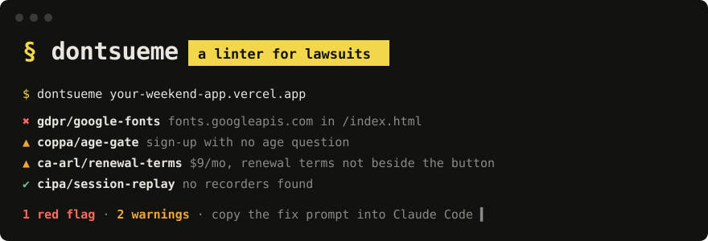
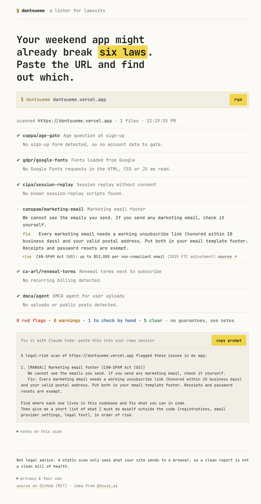
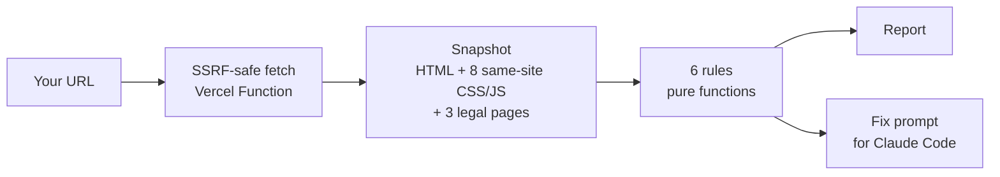

<div align="center">



<h3>Your weekend app might already break six laws. Paste the URL and find out which.</h3>

[](https://dontsueme.vercel.app)
[](LICENSE)
[](https://react.dev)
[](https://www.typescriptlang.org)
[](https://vercel.com/new/clone?repository-url=https://github.com/ertodebana/dontsueme)

</div>

---

You shipped it over the weekend. It works. It also sends every visitor's IP to Google, records their keystrokes, and lets a 12-year-old sign up. **DontSueMe** reads your site the way a browser does and reports six legal traps that vibe-coded apps fall into. It gives each one a fix, and it writes a prompt you can paste into Claude Code to fix the code for you.

```console
$ dontsueme your-app.vercel.app

✖ gdpr/google-fonts       fonts.googleapis.com in /index.html
▲ coppa/age-gate          sign-up found, no age question
◌ canspam/marketing-email newsletter form found, check your email footer
▲ ca-arl/renewal-terms    "$9/mo" found, renewal terms not verified beside the button
✔ cipa/session-replay     no recorders found
✔ dmca/agent              no uploads or public posts detected

1 red flag · 2 warnings · 1 to check by hand · 2 clear
```

<div align="center"></div>

## The six checks

| Rule | The trap | What can happen | What we look for |
|---|---|---|---|
| `coppa/age-gate` | Sign-up never asks for age | COPPA civil penalties up to **$53,088 per violation** ([FTC, 2025](https://www.federalregister.gov/documents/2025/01/17/2025-01361/adjustments-to-civil-penalty-amounts)) | password fields, "sign up" / "create account", Firebase/Supabase sign-up calls; then DOB fields or "13 or older" wording |
| `gdpr/google-fonts` | Fonts loaded from Google's servers | A Munich court awarded a visitor **€100** ([LG München I, 3 O 17493/20](https://www.gesetze-bayern.de/Content/Document/Y-300-Z-BECKRS-B-2022-N-612)); warning letters followed | `fonts.googleapis.com` / `fonts.gstatic.com` in HTML, CSS or JS |
| `cipa/session-replay` | Session replay with no consent | California wiretap suits, **$5,000 per violation** ([Penal Code §637.2](https://leginfo.legislature.ca.gov/faces/codes_displaySection.xhtml?lawCode=PEN&sectionNum=637.2)) | Hotjar, FullStory, Clarity, LogRocket, Mouseflow, Smartlook, Lucky Orange, Inspectlet, PostHog/Sentry replay, and whether a consent manager is present |
| `canspam/marketing-email` | No unsubscribe link or postal address | Up to **$53,088 per email** ([FTC guide](https://www.ftc.gov/business-guidance/resources/can-spam-act-compliance-guide-business)) | Always a manual check: emails can't be seen from outside. We flag newsletter forms and email providers |
| `ca-arl/renewal-terms` | Renewal terms not beside the subscribe button | Renewals count as an **unconditional gift**, so you refund ([B&P §17603](https://leginfo.legislature.ca.gov/faces/codes_displayText.xhtml?lawCode=BPC&division=7.&chapter=1.&part=3.&article=9.)) | "/mo", "billed monthly", Stripe subscription mode; then renewal wording |
| `dmca/agent` | User uploads, no registered DMCA agent | No safe harbor, so statutory damages up to **$150,000 per work** if willful (17 U.S.C. §504(c)) | file inputs, comment sections, public posts; then DMCA / designated-agent text. Register for $6 at [dmca.copyright.gov](https://dmca.copyright.gov) |

Every result is one of `✖ red flag`, `▲ warning`, `◌ check by hand` or `✔ clear`. The report never says "compliant", because a scanner can't know that.

## How it works



- **No database, no accounts, nothing stored.** One function (`api/scan.ts`) fetches your page and returns JSON.
- **Safe to point at the internet.** The fetcher only allows http/https on ports 80/443. It rejects private, loopback, link-local and cloud-metadata addresses *at connect time* (so DNS rebinding doesn't work), re-checks every redirect, and caps time, size and decompressed bytes.
- **It eats its own cooking.** `test/dogfood.test.ts` runs all six rules against our own production build, and the build fails if our site trips one. No Google Fonts (JetBrains Mono is self-hosted), no cookies, and the only analytics is cookieless [GoatCounter](https://www.goatcounter.com) (page views only, no IPs stored, nothing stored on the device).

## What it can't do

Be honest with yourself about these:

- **It's a static scan.** It reads what your server sends: HTML, the CSS/JS that loads up front, and up to three linked legal pages. Anything behind a login, a click, or lazy-loaded from another domain isn't seen.
- **Signals, not verdicts.** Pattern matching has false positives (a blog post *about* Hotjar) and false negatives (a recorder loaded by a tag manager).
- **Emails and button placement are on you.** CAN-SPAM and the "next to the button" part of the renewal law can't be judged from outside.
- **Six laws is not all the laws.** GDPR consent, accessibility, the CCPA and others are not covered (yet).
- **Not legal advice.** If money or kids are involved, talk to a lawyer.

## Run it locally

```bash
git clone https://github.com/ertodebana/dontsueme && cd dontsueme
npm install
npm run dev        # UI + /api/scan on http://localhost:5173
npm test           # builds, then runs rule, SSRF and dogfood tests
```

Node 22+. `npm run dev` serves the scan API through a small Vite middleware, so you don't need the Vercel CLI.

## Add a check

1. Add the law (name, exposure, source) to [`server/laws.ts`](server/laws.ts).
2. Write a `Check` in [`server/checks.ts`](server/checks.ts): a pure function from the snapshot to `pass | warn | fail | manual`, plus evidence and a fix.
3. Add pass and fail fixtures to [`test/checks.test.ts`](test/checks.test.ts), then run `npm test`. The dogfood test makes sure your rule doesn't flag us.

PRs with real-world false positives are the most useful kind.

## Roadmap

- [ ] SEO readiness checks
- [ ] Optional headless-browser mode for client-rendered apps
- [ ] More laws: GDPR cookie consent, EU accessibility act, CCPA "Do Not Sell"
- [ ] A CLI / GitHub Action so the scan runs before deploy

## Credits

The six traps come from a post by [@Voxyz_ai](https://x.com/Voxyz_ai) on X. Penalty figures were re-checked against primary sources in November 2026; FTC figures are the 2025 inflation adjustment. Product names are used only to describe what the scanner detects, and no affiliation is implied. JetBrains Mono is licensed under the SIL Open Font License 1.1.

<sub>**Not legal advice.** DontSueMe gives automated signals about public web pages. It does not determine whether anyone complies with any law. MIT licensed.</sub>
